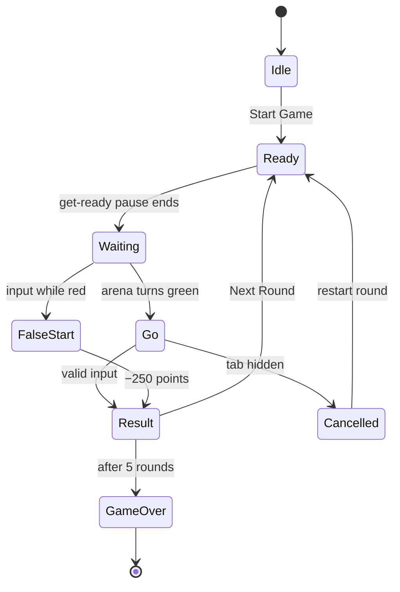
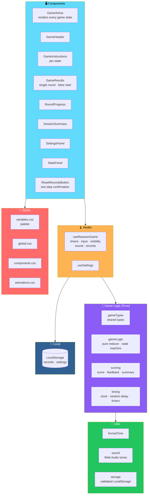

# ⚡ Reflex Rush

<div align="center">


**Wait for green. React fast. Beat your best.**

*A neon-arcade reaction-time game for the browser.*

[🎮 How to Play](#-how-to-play) • [✨ Features](#-key-features) • [⭐ Scoring](#-scoring) • [🏗️ Architecture](#️-architecture) • [🔒 Privacy](#-localstorage-and-privacy)

</div>

---

## 📖 Overview

**Reflex Rush** is a **neon-arcade reaction-time game** for the browser.

### The Rules

1. **Wait** for the arena to turn from **red to green**
2. **Click, tap, or press Space** as fast as you can
3. **Play five rounds** — see your times and score
4. **Try to beat your personal best**

### Core Idea

> **Everything runs in the browser.**
>
> **No backend, no account, no API key, no paid service.**

### The State Machine



---

## ✨ Key Features

<div align="center">

| 🎯 Five-Round Sessions | ⚡ Precise Timing |
|:---:|:---:|
| Clearly defined state machine: **idle → ready → waiting → go → result / false start → game over** | Measured with **`performance.now()`** · captured at the **instant the green signal fires** |
| **🖱️ Three Input Methods** | **❌ False-Start Handling** |
| **Mouse · touch · Space bar** · **the first valid input wins** · **repeats and stray keys are ignored** | **−250 points** · **the round is never counted as a valid measurement** |
| **👀 Tab-Visibility Safety** | **🏆 Personal Records** |
| Hiding the tab during a round **cancels that round** — **instead of recording a bogus time** | **Best average and best score** saved in LocalStorage · **validated on load** |
| **🔊 Optional Sound** | **🎨 Neon Arcade Design** |
| Synthesized with **Web Audio API** · **silent by default** | **CSS-only animation** · **personal-best celebration** · **full reduced-motion support** |
| **📱 Responsive Layout** | **♿ Accessible** |
| Phones · tablets · desktops · **safe-area insets** · **48 px touch targets** | **Semantic HTML** · **visible focus** · **screen-reader announcements** · **text/icon cues in addition to colour** |

</div>

---

## 🎮 How to Play

### Step by Step

1. **Press Start Game**
2. After a short *"get ready"* pause, **the arena turns red**
3. **Wait** for the arena to turn **green** and show **CLICK NOW!**
4. **Click, tap, or press Space** as quickly as you can
5. **If you react while the arena is red** — it's a **false start**
6. **After each round** press **Next Round**
7. **After five rounds** you see the session summary

> ⚠️ **If you switch tabs during a round**, that round is **cancelled** and you restart it manually.

---

## ⭐ Scoring

```js
roundScore = max(0, 1000 - 2 * max(0, reactionTimeMs - 200))
```

<div align="center">

| Reaction Time | Score |
|:-------------:|------:|
| **≤ 200 ms** | **1,000 points** |
| **201 ms** | 998 points |
| **300 ms** | 800 points |
| **400 ms** | 600 points |
| **700 ms** | 0 points |
| **False start** | **−250 points** |

</div>

### 📊 How Session Stats Work

- **The session score** is the **sum of all five rounds**
- **Averages, fastest and slowest times use valid rounds only**
- **A session with no valid rounds shows "—"** instead of an average

### 💬 Feedback Messages

*("Lightning Fast!", "Nice Reaction!", "Keep Building Your Speed!")*

> ⚠️ **These are informal game feedback.**
>
> **They are not a validated measure of ability**, and **one session does not show an improvement in real-world reflexes**.

### 🏆 What Counts as a Personal Best

<div align="center">

| Record | Definition |
|--------|-----------|
| **Best average** | The **lowest average reaction time** across a session with **at least one valid round** |
| **Best score** | The **highest session score** — which **must be greater than zero** |

</div>

---

## 🏗️ Architecture

### System Overview



### 🛠️ Technology Stack

<div align="center">

| Library | Role |
|---------|------|
| **React 18** | Functional components and hooks |
| **TypeScript** *(strict mode)* | Type safety |
| **Vite 6** | Build tool |
| **CSS** *(in `src/styles/`)* | CSS custom properties for the palette |
| **Lucide React** | Icons |
| **Vitest** + **React Testing Library** | Testing |
| **ESLint** *(typescript-eslint, react-hooks)* | Code quality |
| **LocalStorage** | Personal records and settings |

</div>

### Design Principles

<div align="center">

| Principle | Implementation |
|-----------|---------------|
| **🧠 Reducer is pure** | `gameLogic.ts` is a **pure reducer** — the state machine is testable without React, timers, or the DOM |
| **⏱️ Timing is isolated** | `timing.ts` owns the clock, random delay, and timers — **measured with `performance.now()`** |
| **🎯 Scoring is one function** | All scoring lives in `scoring.ts` — **no scoring logic scattered through components** |
| **👀 Visibility matters** | Hiding the tab **cancels the round** — **never records a bogus time** |
| **🛡️ Storage is validated** | Corrupted or unavailable storage **falls back to empty records** — **never crashes the game** |
| **♿ Accessibility first** | Semantic HTML, visible focus, **screen-reader announcements**, and **text/icon cues in addition to colour** |
| **🎨 CSS-only animation** | **No animation library** — pure CSS with **full reduced-motion support** |
| **🔒 No analytics, no cookies** | **Nothing is sent to a server** |

</div>

### 📂 Project Structure

```text
reflex-rush/
├── public/
│   └── favicon.svg
│
├── src/
│   ├── components/
│   │   ├── GameArena.tsx              the central arena
│   │   │                              renders every game state
│   │   ├── GameHeader.tsx
│   │   ├── GameInstructions.tsx       per-state instructions
│   │   ├── GameResults.tsx            single-round result / false start
│   │   ├── ResetRecordsButton.tsx     two-step reset confirmation
│   │   ├── RoundProgress.tsx
│   │   ├── SessionSummary.tsx
│   │   ├── SettingsPanel.tsx
│   │   └── StatsPanel.tsx
│   │
│   ├── game/
│   │   ├── gameTypes.ts               shared TypeScript types
│   │   ├── gameLogic.ts               pure reducer (state machine)
│   │   ├── scoring.ts                 score formula · feedback
│   │   │                              session summary
│   │   └── timing.ts                  clock · random delay
│   │                                  timer manager
│   │
│   ├── hooks/
│   │   ├── useReactionGame.ts         timers · input · visibility
│   │   │                              sound · records
│   │   └── useSettings.ts
│   │
│   ├── styles/
│   │   ├── variables.css
│   │   ├── global.css
│   │   ├── components.css
│   │   └── animations.css
│   │
│   ├── utils/
│   │   ├── formatTime.ts
│   │   ├── sound.ts                   Web Audio synthesized tones
│   │   └── storage.ts                 validated LocalStorage access
│   │
│   ├── App.tsx
│   └── main.tsx
│
├── tests/
│   ├── setup.ts
│   ├── gameLogic.test.ts
│   ├── scoring.test.ts
│   ├── timing.test.ts
│   ├── storage.test.ts
│   └── ui.test.tsx
│
├── index.html
├── package.json
├── tsconfig.json
├── vite.config.ts
├── vercel.json
├── eslint.config.js
├── README.md
└── .gitignore
```

---

## 📋 Prerequisites

- **Node.js 18.18 or newer** *(Node 20 or 22 recommended)*
- **npm 9 or newer**

---

## 🚀 Installation

```bash
npm install
```

---

## 🛠️ Development Commands

```bash
npm run dev       # start the Vite dev server with hot reload
npm run preview   # serve the production build locally
                  # (run `npm run build` first)
```

---

## 📦 Production Build

```bash
npm run build     # type-checks, then writes the static site to dist/
```

---

## 🧪 Testing

```bash
npm run test         # run the whole suite once
npm run test:watch   # watch mode
```

> 💡 **Tests use fake timers and a mocked `performance.now()`** — so they are **deterministic and contain no sleep delays**.

---

## 🔍 Linting and Type Checking

```bash
npm run lint        # ESLint
npm run typecheck   # TypeScript validation with no output files
```

---

## 🚢 Deploying to Vercel

> **The project is a static Vite site and needs no environment variables.**

### Via the Dashboard

1. **Push the repository** to GitHub, GitLab, or Bitbucket
2. In Vercel choose **Add New → Project** and import the repository
3. **Confirm these settings** *(they are also in `vercel.json`)*:
   - **Framework Preset:** Vite
   - **Build Command:** `npm run build`
   - **Output Directory:** `dist`
4. **Click Deploy** — the game is served over HTTPS at the generated URL

### Via the CLI

```bash
npm install --global vercel
vercel          # preview deployment
vercel --prod   # production deployment
```

### ✅ Post-Deploy Check

> **After deploying, play a session, refresh the page, and confirm your records are still shown.**
>
> **That verifies LocalStorage on the live origin.**

---

## 🔒 LocalStorage and Privacy

> **The game stores two small entries in your browser's LocalStorage.**

<div align="center">

| Key | Contents |
|-----|----------|
| **`reflex-rush:records:v1`** | Best average reaction time and best session score |
| **`reflex-rush:settings:v1`** | Sound and reduce-motion preferences |

</div>

### 🛡️ Guarantees

- **Nothing is sent to a server**
- **No analytics**
- **No cookies**
- **Stored data is validated when loaded** — **corrupted or unavailable storage falls back to empty records**
- **You can erase records at any time** with **Reset Personal Records** *(it asks for confirmation)*

### 🔤 Fonts

> **The page requests the Orbitron and Inter fonts from Google Fonts.**
>
> **If they cannot be loaded, the game falls back to system fonts.**

---

## ⚠️ Known Limitations

<div align="center">

| Limitation | Details |
|-----------|---------|
| **⏱️ Input and display latency** | Measured times include input-device and display latency — **which differ between devices** *(touch screens and Bluetooth mice can add tens of milliseconds)*. **Compare times on the same device** |
| **💾 Records are per browser** | Live in **one browser on one device** — **no sync, no leaderboard** |
| **🕵️ Private browsing** | May **block or clear LocalStorage** — in which case **records do not persist** |
| **🔊 Audio gating** | Sound is generated with the Web Audio API and **may be blocked by a browser until the first interaction** |
| **🔧 Fixed constants** | The five-round session length and score constants are **fixed in code** and are **not configurable in the UI** |

</div>

---

## 🗺️ Roadmap

### ✅ Current

- [x] React 18 + TypeScript (strict) + Vite 6 foundation
- [x] Pure reducer state machine — idle, ready, waiting, go, result, false start, game over
- [x] Reaction times measured with `performance.now()` at the instant green fires
- [x] Mouse, touch, and Space bar input — first valid input wins, repeats and stray keys ignored
- [x] False-start handling at −250 points with the round never counted as valid
- [x] Tab-visibility safety — hiding the tab cancels the round instead of recording a bogus time
- [x] Five-round sessions with a summary screen
- [x] Personal records — best average and best score — saved in LocalStorage and validated on load
- [x] Optional synthesized sound effects via Web Audio API, silent by default
- [x] Neon arcade design with CSS-only animation
- [x] Personal-best celebration
- [x] Full reduced-motion support
- [x] Responsive layout with safe-area insets and 48 px touch targets
- [x] Semantic HTML, visible focus, screen-reader announcements
- [x] Text and icon cues in addition to colour
- [x] Two-step reset confirmation for personal records
- [x] Deterministic test suite with fake timers and mocked `performance.now()`
- [x] ESLint and TypeScript type checking
- [x] Vercel deployment configuration included
- [x] No backend, no accounts, no API keys, no paid services

### 🔜 Future Ideas

- [ ] **Session history** and a **progress chart**
- [ ] **Configurable round count** and delay range in the UI
- [ ] **Additional reaction modes** — e.g. target-position or colour-match rounds
- [ ] **Installable PWA** with offline support and self-hosted fonts
- [ ] **Export and import** personal records
- [ ] **Committed screenshots** — idle, waiting, go, result, summary
- [ ] **Local leaderboards** — best sessions over time
- [ ] **Shareable results card** — one-click share of a session summary
- [ ] **Accessibility audit** — deeper screen reader testing
- [ ] **Localization** — bilingual UI

---

## 🤝 Contributing

Contributions are welcome. Please:

1. Fork the repository
2. **Keep the reducer pure** — `gameLogic.ts` must not import React, timers, or the DOM
3. **Keep timing in `timing.ts`** — never scatter `setTimeout` or `performance.now()` calls
4. **Keep scoring in `scoring.ts`** — one function, one source of truth
5. **Preserve tab-visibility safety** — a hidden tab must never record a bogus time
6. **Preserve storage validation** — corrupted or unavailable storage must not crash the game
7. **Preserve accessibility** — semantic HTML, visible focus, screen-reader announcements, text/icon cues in addition to colour
8. **Keep animation CSS-only** — no animation library, and reduced-motion must always work
9. **Update tests** when changing game logic, scoring, timing, or storage
10. Submit a Pull Request

### Guidelines

- **Never record a false start as a valid time**
- **Never record a time from a hidden tab**
- **Never block the game on storage** — fallback is required
- **Never present informal feedback as a measure of ability**
- **Never add a required backend or analytics**
- **Never claim a personal best** without a valid session

---

## 📸 Screenshots

> ⚠️ **Screenshots have not been generated yet.**

**Add them to a `docs/` folder and update these placeholders:**

<div align="center">

| Screen | Placeholder |
|--------|-------------|
| **Idle / start screen** | `docs/screenshot-idle.png` *(placeholder)* |
| **Waiting (red arena)** | `docs/screenshot-waiting.png` *(placeholder)* |
| **Go (green arena)** | `docs/screenshot-go.png` *(placeholder)* |
| **Round result** | `docs/screenshot-result.png` *(placeholder)* |
| **Session summary** | `docs/screenshot-summary.png` *(placeholder)* |

</div>

---

## 📜 License

> ⚠️ **No license has been selected yet.**

**Choose one before publishing or accepting contributions** *(MIT is a common choice for small open-source games)* — **and add a `LICENSE` file.**

---

## 🙏 Acknowledgments

- **Web Audio API** — for sound without audio files
- **CSS animations** — for a neon arcade feel without an animation library
- **Every reflex test that ever made someone say "that one didn't count"** — this one's for you

---

<div align="center">

### ⚡ WAIT. REACT. WIN.

**Wait for green. React fast. Beat your best.**

**No backend. No accounts. No analytics. Everything runs in the browser.**

<br>

⭐ If Reflex Rush tested your reflexes, consider giving it a star.

<br>

[⬆ Back to Top](#-reflex-rush)

</div>
